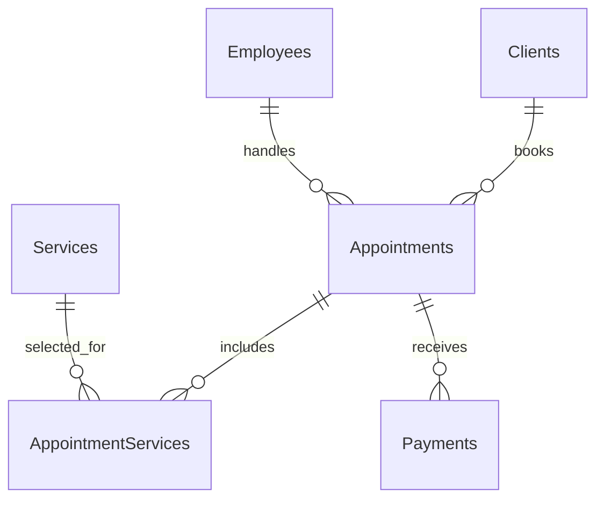
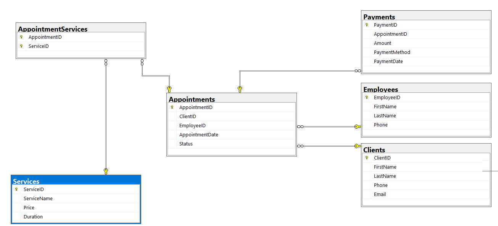

# NailSalonDB 💅 | SQL Server Database Project

A beginner-friendly relational database project for managing a nail salon. Built while learning **SQL Server**, **SQL Server Management Studio (SSMS)**, database design, relationships, and SQL reporting.

## What this project demonstrates

- Relational database design with **6 tables** and **5 foreign keys**
- Primary keys and a composite primary key in the appointment-to-service junction table
- A many-to-many relationship between appointments and services
- A payment amount validation constraint (`Amount > 0`)
- **3 SQL reporting views** for appointment details, payment reconciliation, and service performance

## Database structure

| Table | Purpose |
| --- | --- |
| `Clients` | Client contact information |
| `Employees` | Salon employees |
| `Services` | Services, prices, and durations |
| `Appointments` | Appointment scheduling and status |
| `AppointmentServices` | Links appointments to one or more services |
| `Payments` | Payment amounts, methods, and dates |

### Relationships



## Reporting views

- **`vw_AppointmentReport`**: Combines appointments with client and employee names, estimated duration, end time, booked value, and status.
- **`vw_FinancialReport`**: Shows the booked amount, payments received, and difference for each appointment.
- **`vw_ServicePerformance`**: Counts bookings by service and calculates booked value.

## How to create the database

**Requirements:** Microsoft SQL Server (designed using SQL Server Express) and SSMS or another tool that supports SQL Server `GO` batch separators.

1. Open `NailSalonDB_Schema.sql` in SSMS.
2. Connect to a SQL Server instance where a database named **`NailSalonDB` does not already exist**.
3. Run the script. It creates the database, tables, constraints, foreign keys, and reporting views.
4. Optionally insert your own **fictional test data**.
5. Query the reporting views, for example:

```sql
USE NailSalonDB;
GO
SELECT * FROM dbo.vw_AppointmentReport;
SELECT * FROM dbo.vw_FinancialReport;
SELECT * FROM dbo.vw_ServicePerformance;
```

> **Important:** This is a **schema-only** export. It does **not** contain records or sample INSERT statements, so the views return no rows until test data is added. Do not run this setup script on the original database you already use in SSMS.

## Files

- [`NailSalonDB_Schema.sql`](NailSalonDB_Schema.sql) — SQL schema, constraints, relationships, and reporting views

## Skills practiced

`SQL Server` · `T-SQL` · `SSMS` · `Database Design` · `Primary Keys` · `Foreign Keys` · `JOIN` · `GROUP BY` · `CTEs` · `Views` · `Reporting`

## Next steps

- Add fictional sample data and setup instructions
- Add screenshots of the ERD and sample query results
- Organize additional data validation and KPI analysis queries

*Learning project. No real client information is included.*


